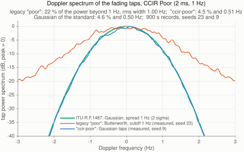
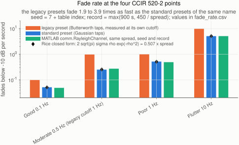

# Watterson channel model: the standard's Doppler spectrum and named presets

**Status:** design record for the `channel-model` change, 2026-10-10
**Author:** Joseph Freivald
**Scope:** `common/watterson.{c,h}`, `utils/watterson_test`, `utils/chanutil`, tests. No modem change.

## Why

Every fading number this project reports goes through `common/watterson.c`.
Its taps were shaped by a second-order Butterworth low-pass run at the
sample rate with its 3 dB cutoff at the path's `doppler_hz`. Measured by
pushing a tone through the channel and taking the spectrum of the complex
envelope (`tests/matlab/TestChannel.m`), that process is not the one the
standards define:

- **Wrong width.** CCIR 520 and ITU-R F.1487 state a path's "Doppler spread"
  as twice the standard deviation of a Gaussian spectrum. The Butterworth
  cutoff measures as the spectrum's rms width itself, so the preset called
  "poor" with "1 Hz" has an rms width of 1.0 Hz where CCIR Poor has 0.5 Hz,
  and it fades at about twice the rate: 1.04 fades below −10 dB per second
  against 0.47 for the standard.
- **Wrong shape.** A second-order Butterworth rolls off at 12 dB per octave.
  23 % of the tap power sits beyond the nominal spread against 4.6 % for the
  Gaussian, which puts the deep, fast fades at the wrong rate too.
- **Wrong presets.** "good" had a single path and no multipath at all,
  "moderate" used 1 Hz where CCIR Moderate is 0.5 Hz, "flutter" used 2 ms
  where CCIR Flutter is 0.5 ms.
- **Numerically fragile.** At 48 kHz the filter's poles sit within 1e-4 of
  the unit circle, which `tests/common/test_watterson.c` already guards in
  double precision.
- **One sample short.** Found by the new validation: the delay line wrote
  the current sample and then read the next slot, so every path arrived one
  sample earlier than configured, 0.375 ms for a 0.5 ms path at 8 kHz, and a
  path under one sample had no delay at all.

The consequence is that a Mercury result on "poor" could not be set next to
a VARA or ARDOP result on CCIR Poor, and a 2 dB fading margin measured on
this channel was a margin against the wrong channel.





## What changes

**The tap process.** Each fading path is now a complex Gaussian process with
a Gaussian Doppler power spectrum whose spread (2 sigma) is the path's
`doppler_hz`: white complex Gaussian noise generated at a low rate of about
64 times the spread, shaped by the sampled Gaussian impulse response
exp(−4π²σ²t²) truncated at 1e-4, scaled to unit tap power, and linearly
interpolated to the sample rate. The low-rate generation is what makes it
exact at any sample rate: the filter never sees fs. The history is
pre-filled with noise so a tap starts in its steady-state distribution.

**The delay line** reads its slot before writing it, so a path is delayed by
exactly `ceil(delay_ms * fs / 1000)` samples. The legacy spectrum keeps the
old line, one sample short, so that its pinned realisations are unchanged;
`tests/common/test_watterson.c` pins both behaviours, and the legacy presets
were checked byte for byte against the v1.9.17 tool on the same seed.

**The parameter.** `doppler_hz` means the standard's Doppler spread. The
Butterworth path is kept as `WATTERSON_SPECTRUM_LEGACY`, selected by
`watterson_set_spectrum()` or `watterson_test --legacy`, where `doppler_hz`
keeps its old meaning. The pinned-seed hash test selects it explicitly and
is unchanged.

**Named presets**, one table in `watterson.c` used by `watterson_test`
(`--preset NAME` or `--NAME`, so `MERCURY_CH_FADING=ccir-poor` works in the
integration bench) and by `chanutil` (the same names):

| preset | source | delay spread | Doppler spread |
|---|---|---|---|
| `ccir-good` | CCIR 520-2 Good | 0.5 ms | 0.1 Hz |
| `ccir-moderate` | CCIR 520-2 Moderate | 1 ms | 0.5 Hz |
| `ccir-poor` | CCIR 520-2 Poor | 2 ms | 1 Hz |
| `ccir-flutter` | CCIR 520-2 Flutter | 0.5 ms | 10 Hz |
| `itur-lq` / `itur-lm` / `itur-ld` | F.1487 low latitude quiet / moderate / disturbed | 0.5 / 2 / 6 ms | 0.5 / 1.5 / 10 Hz |
| `itur-mq` / `itur-mm` / `itur-md` | F.1487 mid latitude quiet / moderate / disturbed | 0.5 / 1 / 2 ms | 0.1 / 0.5 / 1 Hz |
| `itur-mdv` | F.1487 mid latitude disturbed NVIS | 7 ms | 1 Hz |
| `itur-hq` / `itur-hm` / `itur-hd` | F.1487 high latitude quiet / moderate / disturbed | 1 / 3 / 7 ms | 0.5 / 10 / 30 Hz |

All are two equal-power paths. The legacy names `good`, `moderate`, `poor`,
`flutter`, `mpg`, `mpp`, `mpd` keep their old taps and numbers so the results
in `docs/FADE-CLIFF-DECISION.md` and `docs/MFSK-PORT.md` that cite the
Watterson harness reproduce from the same commands. New measurements should
use the standard names.

## Validation

`tests/matlab/TestChannel.m` (MATLAB R2026a, Communications Toolbox) runs
every preset through `watterson_test` and measures, from the tap process:
the rms width of the Doppler spectrum against spread / 2, the fraction of
power beyond the spread against the Gaussian's 4.55 %, the spectrum's shape
error against the Gaussian, the amplitude distribution against Rayleigh
(Kolmogorov distance), the fade rate below −10 dB against
`comm.RayleighChannel` with the same Gaussian Doppler spectrum, and the path
delay from a chirp's cross-correlation. Gates: width within 12 %, tail
within 2 points, shape error under 0.10, Kolmogorov distance under 0.03,
fade rate within 25 % of MATLAB, delay within one sample. The legacy presets
are measured and logged, not gated.

Measured (MATLAB R2026a, seed 7, 450 fade cycles per preset; the legacy rows are reported, not gated):

| preset | delay / spread | rms width (standard: spread / 2) | power beyond spread (Gaussian 4.6 %) | shape error | Rayleigh KS | fades/s below −10 dB, model / MATLAB | echo, samples |
|---|---|---|---|---|---|---|---|
| `ccir-good` | 0.5 ms / 0.10 Hz | 0.050 (0.050) | 4.2 % | 0.039 | 0.009 | 0.052 / 0.049 | 4 of 4 |
| `ccir-moderate` | 1.0 ms / 0.50 Hz | 0.245 (0.250) | 4.0 % | 0.088 | 0.013 | 0.239 / 0.240 | 8 of 8 |
| `ccir-poor` | 2.0 ms / 1.00 Hz | 0.500 (0.500) | 4.4 % | 0.054 | 0.012 | 0.521 / 0.479 | 16 of 16 |
| `ccir-flutter` | 0.5 ms / 10.00 Hz | 4.991 (5.000) | 4.6 % | 0.016 | 0.003 | 5.006 / 5.071 | 4 of 4 |
| `itur-lq` | 0.5 ms / 0.50 Hz | 0.247 (0.250) | 4.1 % | 0.087 | 0.012 | 0.264 / 0.240 | 4 of 4 |
| `itur-lm` | 2.0 ms / 1.50 Hz | 0.746 (0.750) | 4.3 % | 0.082 | 0.006 | 0.759 / 0.731 | 16 of 16 |
| `itur-ld` | 6.0 ms / 10.00 Hz | 4.985 (5.000) | 4.6 % | 0.019 | 0.002 | 5.058 / 5.071 | 48 of 48 |
| `itur-mq` | 0.5 ms / 0.10 Hz | 0.050 (0.050) | 4.2 % | 0.039 | 0.009 | 0.052 / 0.049 | 4 of 4 |
| `itur-mm` | 1.0 ms / 0.50 Hz | 0.245 (0.250) | 4.0 % | 0.088 | 0.013 | 0.239 / 0.240 | 8 of 8 |
| `itur-md` | 2.0 ms / 1.00 Hz | 0.500 (0.500) | 4.4 % | 0.054 | 0.012 | 0.521 / 0.479 | 16 of 16 |
| `itur-mdv` | 7.0 ms / 1.00 Hz | 0.500 (0.500) | 4.4 % | 0.054 | 0.012 | 0.521 / 0.479 | 56 of 56 |
| `itur-hq` | 1.0 ms / 0.50 Hz | 0.245 (0.250) | 4.0 % | 0.088 | 0.013 | 0.239 / 0.240 | 8 of 8 |
| `itur-hm` | 3.0 ms / 10.00 Hz | 4.985 (5.000) | 4.6 % | 0.019 | 0.002 | 5.058 / 5.071 | 24 of 24 |
| `itur-hd` | 7.0 ms / 30.00 Hz | 14.963 (15.000) | 4.6 % | 0.010 | 0.002 | 15.215 / 15.230 | 56 of 56 |
| `good` (legacy) | cutoff 0.10 Hz | 0.099, i.e. a 0.20 Hz spread | 21.7 % | 0.149 | 0.008 | 0.095 / n.a. | one short, as before |
| `moderate` (legacy) | cutoff 1.00 Hz | 0.987, i.e. a 1.97 Hz spread | 21.8 % | 0.165 | 0.008 | 0.999 / n.a. | one short, as before |
| `poor` (legacy) | cutoff 1.00 Hz | 0.987, i.e. a 1.97 Hz spread | 21.8 % | 0.165 | 0.008 | 0.999 / n.a. | one short, as before |
| `flutter` (legacy) | cutoff 10.00 Hz | 9.886, i.e. a 19.77 Hz spread | 22.2 % | 0.179 | 0.002 | 9.742 / n.a. | one short, as before |
| `mpg` (legacy) | cutoff 0.10 Hz | 0.099, i.e. a 0.20 Hz spread | 21.9 % | 0.174 | 0.011 | 0.097 / n.a. | one short, as before |
| `mpp` (legacy) | cutoff 1.00 Hz | 0.987, i.e. a 1.97 Hz spread | 21.8 % | 0.165 | 0.008 | 0.999 / n.a. | one short, as before |
| `mpd` (legacy) | cutoff 2.00 Hz | 1.962, i.e. a 3.92 Hz spread | 21.6 % | 0.142 | 0.003 | 1.969 / n.a. | one short, as before |

All 21 tests pass; every standard preset is within 1 % of the standard's
Doppler width, within 0.6 points of the Gaussian tail, Rayleigh to a
Kolmogorov distance under 0.015, within 10 % of MATLAB's fade rate (9 % on
the 1 Hz presets, under 2 % elsewhere), and echoes at exactly the configured
sample. The legacy presets measure a spread of twice their nominal cutoff
and 22 % of their power beyond it.

`tests/common/test_watterson.c` adds three C tests: unit tap power with the
autocorrelation at τ = 1/(πD) equal to e^−½ on the Gaussian path, the same
answers at 8 and 48 kHz, and the delay line's echo at exactly the configured
number of samples (and one short on the legacy path, as it was).

## Reproduce

```sh
make && make -C utils watterson_test && make -C tests test_watterson && ./tests/test_watterson
utils/watterson_test --preset ?                    # lists the presets
utils/watterson_test in.s16 out.s16 --ccir-poor --No -20
# MATLAB: cd tests/matlab; runtests('TestChannel'); plot_channel_figures
```
