# LDPC decoder: persistent context, min-sum / table sum-product, decode deadline, opt-in LLR calibration

**Status:** design record for the `ldpc-decoder` change set, 2026-10-08
**Author:** Joseph Freivald
**Scope:** receiver only, no wire change; every existing caller of
`run_ldpc_decoder()`, `encode()`, `ldpc_decode_frame()`, `symbols_to_llrs()`
compiles and behaves as before unless it opts in.

## Why

Measured with `utils/golden/ldpc_sweep`, in C, on all seven data-mode codes:
BPSK over AWGN, 600 frames per point or 30 errors per variant, every variant
decoding the same frames (data in `docs/ldpc-figures/data/ldpc_fer_*.csv`;
`ldpc_sweep --crossings FILE` prints every number below from a file). A
MATLAB-driven run of the same sweep on 2026-10-09, kept as dated data in
`docs/ldpc-figures/data/matlab-2026-10-09/`, agreed on the headline column
within 0.1 dB on the six longer codes and put MATLAB's own belief propagation
within 0.04 dB of the C sum-product.
"Deployed" is what a desktop Mercury runs: codec2's SumProduct at the code
tables' limit of 100 iterations with LLRs scaled by the per-mode constant
`EsNodB` (3 dB, 10 dB for the 16200-bit code).  The 10-iteration cap in
`freedv_700.c` ("limit CPU load") is under `#ifdef __EMBEDDED__` and applies
only to embedded builds; the last column is the TOTAL for such a build
(cap-10 deployed -> new), of which the cap itself is 0.4 to 0.65 dB on the five longer
codes and 0.24 dB on HRA_56_56.  "New" here is the policy decoder fed correctly scaled LLRs, which is
the opt-in configuration (see "LLR scale"); crossings are read off a 0.5 dB
grid by log-linear interpolation, +-0.1 dB.

| code (modes) | deployed -> new, FER 1e-1 | FER 1e-2 | of which LLR scale | embedded build (cap 10) -> new, FER 1e-1 |
|---|---|---|---|---|
| HRA_56_56 (DATAC14) | −0.03 dB | −0.07 | 0.07 | 0.21 |
| H_128_256_5 (DATAC0) | 0.15 | 0.13 | 0.12 | 0.55 |
| H_256_512_4 (DATAC13) | 0.14 | 0.27 | 0.13 | 0.79 |
| H_256_768_22 (DATAC15/16) | **1.08** | **1.37** | 1.04 | 1.47 |
| H_1024_2048_4f (DATAC3/4) | 0.74 | 0.82 | 0.70 | 1.22 |
| H_4096_8192_3d (DATAC1) | **1.19** | **1.31** | 1.11 | 1.78 |
| H_16200_9720 (DATAC17/QAM16C2) | n/a in BPSK (its 10 dB constant never decodes; equal to legacy given exact LLRs) | | 0.33 at 16-QAM (0.17 at FER 1e-2), from `llr_scale_H_16200_9720.csv` | 1.33, exact LLRs on both sides because the constant never decodes |

The SumProduct implementation itself is correct (the context sum-product is
within 0.02 dB of the legacy loop on every code, and the dated MATLAB run put
MATLAB's belief propagation within 0.04 dB of it at 50 iterations with exact
LLRs).  On a desktop the loss is
the LLR scale: the fixed `EsNodB` is right at one operating point only, and a
sum-product decoder fed over-confident LLRs converges to the wrong codeword
rather than slowly, so more iterations do not recover it (the "of which"
column is the whole gain on every code).  It costs 0.8 to 1.4 dB at FER 1e-2 on
the three QPSK codes that carry the ARQ ladder and 0.2 to 0.3 dB at 16-QAM.
On an embedded build the cap adds another 0.4 to 0.65 dB.

That scale gain is a code-level number, measured with the TRUE Es/No.  Taking
the scale from the receiver's own Es/No estimate is a different thing, and it
measured as a loss end to end on the 16200-bit modes; the calibration is
therefore in the tree but off by default.  See "LLR scale" below.

The CPU concern behind that cap is real on small boards but was being paid
in the wrong place: the decoder rebuilt its graph with one heap allocation per
node on every call (22,684 allocations and 1.84 MB per 16200-bit decode,
counted under valgrind), visited every edge through two pointer indirections, and called the
transcendental `phi0()` twice per edge per iteration; `-O3` changed nothing
because it is memory-bound.  It also tested parity on the extrinsic message
signs instead of the hard decisions, so it kept iterating after it had found
the codeword and reported a pessimistic parity count.

## What changes

`modem/freedv/ldpc_ctx.{c,h}` (new): a persistent context per `struct LDPC`.
The Tanner graph is built once in a structure-of-arrays layout: rows sorted
by degree and packed eight to a block with slots interleaved so vector lanes
are rows; CSR in both directions; messages per slot; a per-slot hard-bit
array so the parity check is a streaming XOR.  Zero allocations in the decode
path (ASan/UBSan clean).  Four algorithms share the layout:

| algorithm | what | when |
|---|---|---|
| `sp` | phi-domain sum-product with the original `phi0()` | result-equivalent to legacy, A/B reference |
| `spt` | sum-product with a two-segment interpolated phi table, no call per edge | default on H_1024_2048_4f, H_4096_8192_3d, H_16200_9720 and the short voice codes |
| `nms` | normalised min-sum, float | reference for `nms16` |
| `nms16` | normalised min-sum, int16 1/16-LLR fixed point, check pass in 8-lane 128-bit vectors (compiler vector extensions: SSE2 on x86-64; NEON on arm64, and on armv7 only with `-mfpu=neon`, which `config.mk` does not pass, so 32-bit Pi builds get correct scalar code) | default on the four short data codes (HRA_56_56, H_128_256_5, H_256_512_4, H_256_768_22) and two 2020 codes |

Per-code policy and min-sum scale come from the C sweep (`ldpc_sweep --fer`
and `--nms-scale`, data under `docs/ldpc-figures/data/`).
Min-sum is kept only where its WHOLE FER curve tracks sum-product, not just
the 10 % and 1 % crossings.  On H_4096_8192_3d (DATAC1) the crossings match,
but above 10 % FER, where a fading channel spends its time, min-sum is 1.7x
worse (Eb/N0 1.25 dB, 50 iterations, 2000 frames, exact LLRs: `sp` 0.232,
`spt` 0.214, `nms` 0.378, `nms16` 0.407, each +-0.01;
`docs/ldpc-figures/data/above_cliff_H_4096_8192_3d.csv`), and end to end it cost
DATAC1 2 to 5 frames in 200 in
moderate fading (review of #359, reproduced).  An earlier comment, "0.85
beats BP@50", compared crossings, not curves; the code runs `spt`.  The
min-sum scales (0.85 / 0.70 / 0.80) stay for anyone forcing `nms`; the C
scale sweep (`nms_scale_c.txt`, float `nms` against `sp` at 50 iterations)
puts 0.85 within 0.01 dB of sum-product on H_256_768_22 (0.75 costs
0.3 dB) and within 0.06 dB on H_4096_8192_3d, while on H_1024_2048_4f every
scale trails by at least 0.2 dB at FER 10 % (0.70 least) and on
H_16200_9720 by 0.5 dB, which is why those two run `spt`.
`LDPC_ALG=auto|sp|spt|nms|nms16|legacy` or `ldpc_set_default_alg()` select;
the environment is read once (`pthread_once`), and an explicit
`ldpc_set_default_alg()` wins.

**What the voice and 2020 modes run.** Every code the AUTO policy can choose
for is in the policy table with a measured entry, voice included: the seven
data-mode codes, the two voice codes HRA_112_112 (700D) and HRA_56_56
(700E), and the 2020 codes HRAb_396_504, HRAa_1536_512 and
H_2064_516_sparse all went through the same C sweep. The short voice
codes favour the table sum-product (0.1 to 0.2 dB over min-sum at FER 10 %,
and within 0.01 dB of the legacy loop); the 2020 codes are equal across
algorithms within 0.07 dB and take the fastest. Curves in
`ldpc-figures/data/`. A code not in the table decodes with `sp`. The legacy
loop stays reachable process-wide (`LDPC_ALG=legacy`) for A/B until the team
retires it.

**How a decode is bounded.** A voice frame is bounded by its own frame
period, not by an iteration count: the voice and 2020 opens set a per-decode
budget of a quarter of the modem frame period (`LDPC_VOICE_BUDGET_FRAC`:
700D 160 ms gives 40 ms, 700E 80 ms gives 20 ms), the rx path computes the
deadline from it before every decode, and the iteration cap is the code
table's limit on every build. That is hundreds of iterations of those codes
on a PC, and on an embedded board the bound the old `__EMBEDDED__` cap of 10
approximated, in the units that matter: a decode that outlasts its frame is
useless. A data frame's bound is the ARQ's ACK window, which only the host
knows: Mercury sets it per pooled instance from its timing, and the instance
then runs to the table's limit under that deadline; an embedded host that
sets no budget keeps codec2's cap of 10 iterations exactly as before, and
clearing a budget restores it. FSK_LDPC keeps its cap of 15 the same way.
`tests/modem/test_ldpc_modes.c` pins the derived budgets and both cap rules
through the FreeDV API.

**Shared state.** The two-segment phi table is filled once by `pthread_once`,
so contexts may be created from any thread; `tests/modem/test_ldpc_ctx.c`
creates eight concurrently and the suite runs clean under ThreadSanitizer.

`run_ldpc_decoder()` is unchanged in signature: it lazily creates the context
(new trailing `ctx` field in `struct LDPC`), honours `ldpc->deadline_ns` and
fills `ldpc->last_stats` / `decode_count`.  `run_ldpc_decoder_ex()` takes an
explicit monotonic deadline and returns `ldpc_stats_t` (iterations, parity
count, parity ok, deadline hit).  `run_ldpc_decoder_legacy()` keeps the old
code for comparison.

FreeDV API: `freedv_set_ldpc_budget_ms()`, `freedv_set_ldpc_max_iter()`,
`freedv_get_ldpc_stats()`, `freedv_set_llr_calibrated()`,
`freedv_get_llr_esno_db()`.  `max_iter` default 100 (`LDPC_MAX_ITER_DEFAULT`).

Mercury: `modem.c` derives each pooled mode's budget as
min(`budget_guard_frac` x ARQ channel guard, `budget_air_frac` x frame
airtime), defaults 0.5 and 0.25 (350 ms today, guard-limited), passes it to
the backend (`set_ldpc_budget` / `get_ldpc_stats` vtable hooks), accumulates
decodes, mean iterations, deadline hits and parity failures per mode, logs
them at shutdown and publishes `ldpc_iters_last`, `ldpc_iters_mean`,
`ldpc_deadline_hits`, `ldpc_max_iter` on the status JSON.  `[ldpc]` in
`mercury.ini` (`max_iter`, `budget_ms`, `budget_guard_frac`,
`budget_air_frac`, `alg`).  `mercury -B` times every code and algorithm on the
host.

Demapper (`mpdecode_core.c`): `llr_from_qam()` is a generic max-log demapper
over any constellation table with per-symbol amplitude and an Es/No scale;
`qam_constellations.h` holds unit-power tables for 32 (cross), 64, 128
(cross) and 256-QAM, generated once with MATLAB's `qammod` and checked in C
by `tests/modem/test_llr_qam.c` (unit power and the nearest-neighbour
Hamming histogram of each table); `symbols_to_llrs()` and
`psk_modulate_frame()` accept 5-8 bits per symbol, the QPSK and 16-QAM paths
are untouched.  The "decoded information bits all zero" early exit of the old
loop (a test hook fed a zero reference vector in production) is gone.

**LLR scale.** Default: the mode constant `EsNodB`, exactly as shipped.
Opt-in (`LDPC_LLR_CALIBRATED=1` or `freedv_set_llr_calibrated(1)`): per
packet, the receiver's Es/No estimate is passed through the existing per-mode
SNR calibration (`freedv_snr_calib`) and mapped back from SNR3k to Es/No by
subtracting the bandwidth + cyclic-prefix term, clamped to -3..20 dB.  HARQ
Chase combining sums LLRs when they are calibrated and keeps the shipped
average otherwise.

Why it is off: the reviewer measured about 1 dB of loss on DATAC17 and
QAM16C2 with the calibrated scale, mostly in fading, and it reproduces.  Fixed
mode, one frame per burst, the same faded file decoded by every arm
(`freedv_data_raw_tx` -> `watterson_test` -> `freedv_data_raw_rx
--testframes`, 150 frames per point, `watterson_test --moderate`, seeded
with `MERCURY_WATTERSON_SEED`; the sweep script that drives it belongs to the
bench change set and is not in this one; data in
`ldpc-figures/data/llr_scale_end_to_end.csv`):

| mode, channel | in-burst SNR3k | calibrated | fixed scale (default) | legacy loop, fixed | `sp`, fixed | receiver's SNR estimate |
|---|---|---|---|---|---|---|
| DATAC17, moderate | 8.6 dB | 0.90 | 0.95 | 0.95 | 0.95 | 7.4 dB |
| DATAC17, moderate | 7.6 dB | 0.70 | 0.82 | 0.82 | 0.82 | 6.7 dB |
| DATAC17, moderate | 6.6 dB | 0.34 | 0.46 | 0.45 | 0.45 | 6.3 dB |
| DATAC17, moderate | 5.6 dB | 0.03 | 0.15 | 0.15 | 0.15 | 6.0 dB |
| DATAC17, AWGN | 3.0 dB | 0.17 | 0.69 | 0.65 | 0.66 | 3.9 dB |
| QAM16C2, moderate | 13.5 dB | 0.58 | 0.70 | 0.70 | 0.70 | 12.7 dB |
| QAM16C2, moderate | 12.5 dB | 0.43 | 0.57 | 0.57 | 0.57 | 12.4 dB |
| QAM16C2, moderate | 11.5 dB | 0.22 | 0.38 | 0.38 | 0.38 | 12.1 dB |
| QAM16C2, moderate | 10.5 dB | 0.04 | 0.15 | 0.15 | 0.15 | 12.1 dB |

Delivery = frames passing CRC / frames sent.  Three things follow.  The three
fixed-scale arms agree on every one of the 60 points, so on those modes and
channels the new decoder on the shipped scale delivers the same frames as the
shipped decoder (end to end, with the ARQ in the loop, the table sum-product
is slightly better on DATAC1; see "The defaults against 1.9.18").  The calibrated arm loses
0.1 to 0.5 of delivery across the cliff on both 16200-bit modes, and 0.01 to
0.02 even at 12 to 18 dB in fading, which is the under-confident tail.  And
the last column is the cause: in fading the estimate compresses (12 dB
reported at 18 dB in, and the `freedv_snr_calib` knots start at 11.6 dB for
DATAC17, so the mapping extrapolates below its first knot), so the LLRs come
out under-confident relative to what the codes were tuned on.  Off is the
safe default, not the fix.  The fix, for a future change, has three parts.
First, the standard channel model for the harness (Gaussian Doppler spectrum,
CCIR and ITU-R presets), without which the fading under test is about twice
too fast.  Second, two estimates instead of one: the ARQ ladder needs the
channel SNR, to predict which mode will decode, while the decoder needs the
noise variance at the demapper, which in fading includes the channel
estimation error; one number cannot serve both.  For the LLR scale that means
a decision-free estimate from the pilot error vectors, smoothed over frames
(the per-packet estimate is noisy, and a noisy scale hurts the sum-product
decoder near the cliff), and the ladder's SNR re-calibrated per mode on the
standard presets.  Third, validation by FER rather than by estimate accuracy:
per mode and per preset, the gap between the FER curve with the new estimate
and the curve with the true noise variance (`ldpc_sweep --llr-scale` gives
that reference at the code level)
decides where the calibration is turned on, paired with the per-rung ladder
re-tune because the thresholds were tuned against today's estimate.  The sweep
records `snr_modem` next to the channel's truth for this purpose.  Until then
the constant is the default and nothing in the RF behaviour of the receiver
changes.

## Measured

Per iteration, Apple M5 Pro, cliff fixtures (`utils/golden/fixtures/llr`,
written by `ldpc_sweep --fixture`: 100 frames per code at Es/N0 −3.0, −1.5,
−1.4 and −0.9 dB):

| code | legacy us/iter | spt | nms16 | policy | ms per frame, cap 50, legacy -> policy |
|---|---|---|---|---|---|
| H_256_768_22 | 25.8 | 9.2 | 2.3 | nms16 | 0.59 -> 0.029 |
| H_1024_2048_4f | 84.5 | 33.1 | 8.7 | spt | 2.22 -> 0.56 |
| H_4096_8192_3d | 299 | 100 | 29.1 | spt | 9.89 -> 2.19 |
| H_16200_9720 | 659 | 288 | 114 | spt | 26.3 -> 9.17 |

Method: `utils/golden/ldpc_bench --mi 50` on the 100-frame cliff fixtures,
timing the decoder calls in process (file I/O and start-up excluded), median
of three runs after a warm-up run; run to run spread under 3 %.  The
per-frame gain exceeds the per-iteration gain because parity is tested on the
hard decisions, so a decode stops when it has the codeword (legacy 23 to 40
iterations per frame on these fixtures, the context 12 to 32).  An earlier
version of this table timed the whole process, which inflated the small
code's numbers.

Working memory per code, measured with `ldpc_ctx_bytes()`: 56 KB (768),
230 KB (2048), 674 KB (8192), 1,776 KB (16200), allocated once and kept; the
old loop allocated and freed 61 / 228 / 713 / 1,800 KB on every call (1,284 /
3,076 / 12,292 / 22,684 allocations per decode, counted under valgrind;
the new path makes none after the context exists).  The
context holds the graph in both directions plus message buffers for both the
float and the int16 paths, so the path in use touches about a third of it
(19 / 70 / 221 / 554 KB); allocating only the active path's buffers is a
follow-up.

Statistical resolution of the curves: 600 frames per point with an adaptive
stop, so a point at FER 1e-2 rests on about 6 errors (+-40 % relative) and a
crossing read off the 0.5 dB grid carries about +-0.1 dB; equivalence claims
(`sp` vs legacy, `nms16` vs `nms`) compare the same frames, so they are exact
where they say 0.00 dB. Two independent 600-frame runs of the sweep, the C
run recorded here and the dated MATLAB-driven run, agree on the
deployed-to-new column within 0.1 dB on the six longer codes and within
0.3 dB on HRA_56_56, whose curve is shallow.  In the end-to-end table below, 150 frames per point
put +-0.04 on a delivery of 0.5, and the "1 to 2 %" tail at 12 to 18 dB is 14
failures in 900 frames against none, not any single point.

Sweep results (`ldpc_sweep`, crossings at FER 10 % unless stated): context
`sp` vs legacy within 0.02 dB on every code; `spt` vs `sp` within 0.04 dB,
and never worse at FER 1 %; `nms16` vs float `nms` within 0.02 dB (0.05 at
FER 1 %); `nms` immune to the LLR scale (0.00 dB on every code); fixed-EsNo
scale cost at the real modulation 0.19 dB (DATAC15/16, QPSK), 0.05 dB
(DATAC1, QPSK), 0.33 dB (QAM16C2, 16-QAM; 0.17 dB at FER 1e-2). The max-log
demapper matches an independent max-log reference in `test_llr_qam.c` to a
relative error below 2e-7 for 2 to 8 bits per symbol; the dated MATLAB run
also matched MATLAB's approximate-LLR demodulator to 2e-7.

Unit tests: `tests/modem/test_ldpc_ctx.c` (11: graph, legacy equivalence on
the shipped vector, min-sum, one-iteration clean decode, deadline, wrapper
lifecycle, struct-path deadline and stats, eight-thread context creation,
extreme LLRs (+-1e9, +-inf, NaN) saturate instead of wrapping, min-sum scale
clamp, eight concurrent first decodes through the wrapper; ASan+UBSan and TSan
clean), `tests/modem/test_ldpc_modes.c` (5: voice frame-period budgets, the
policy per code, the cap/budget rule, calibration off unless enabled,
`LDPC_ALG` read once), `tests/modem/test_llr_qam.c` (6: tables, sign
correctness, Somap agreement, high-order modulate/demap round trip, the
nearest-neighbour Hamming histogram of every table, max-log against an
independent reference); `tests/modem/test_ldpc_fer.c` (6, on pinned frames
from `mercury_prng`, under 1 s: `sp` and legacy agree on H_256_768_22 at its
cliff within 3 frames of 200, `spt` and `nms16` within 6, float `nms` is
bit-exact under power-of-two LLR scaling, the fixed-EsNo constant costs
frames where exact LLRs decode, every code's codewords satisfy every check
row of `ldpc_ctx_row_indices` and are systematic, and the legacy loop's
all-zero halt is pinned);
`tests/modem/test_freedv_harq.c` unchanged and passing;
`tests/gui_interface/test_ui_status.c` pins the appended fields.


## Figures

Drawn on 2026-10-09 by a MATLAB script from the dated run's curves
(`docs/ldpc-figures/data/matlab-2026-10-09/`) and kept as drawn: the C sweep
reproduces those curves within the scatter stated above, so the figures are
not regenerated. The series "MATLAB belief propagation" in the waterfalls is
MATLAB's own decoder, which has no C counterpart. Every waterfall is 600
frames per point, BPSK over AWGN, exact LLRs unless stated.

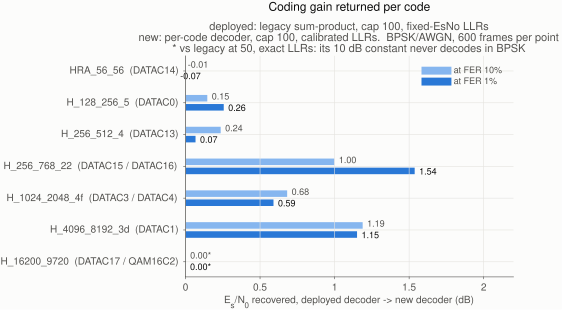

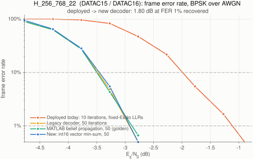
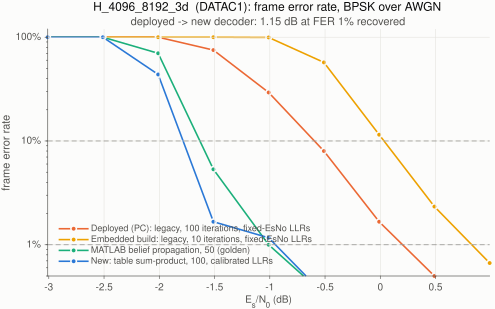
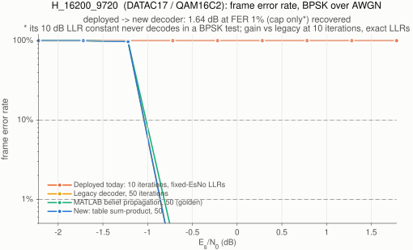
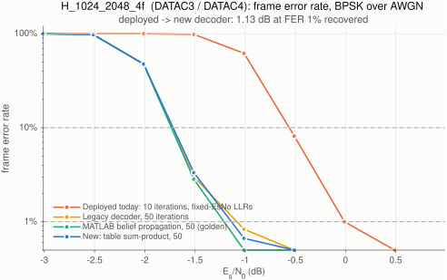
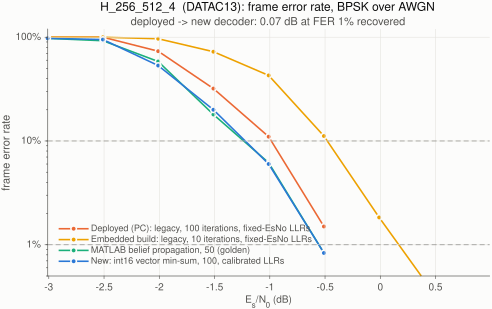
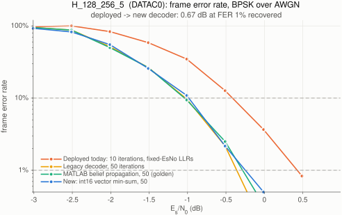
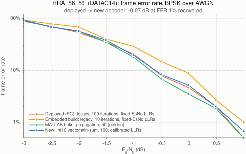

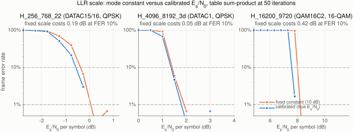
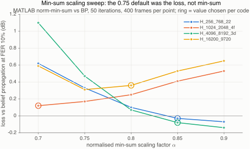
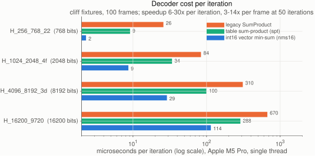
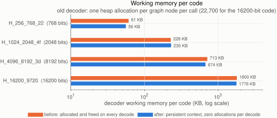

## End-to-end A/B against the shipped binary

Two `mercury` processes over the deterministic `-x sock` bench
(`tests/integration`, Watterson channel, AWGN only, seeded), paced in real
time so the DSP threads see a radio's timeline.  Three arms, same seeds:
the pristine v1.9.17 binary on both stations (`trunk`, built from the merge
base), this tree with the defaults of the time (`new`), and this tree forced
to the embedded build's decoder (`cap10`, now the `emul` arm: `LDPC_ALG=legacy
LDPC_MAX_ITER=10`).  The `new` arm in these runs had the calibrated LLR scale
ENABLED (it was the default when they were made; it is opt-in now, see "LLR
scale"), so its 10 % / 5 % link-time gain is what `LDPC_LLR_CALIBRATED=1`
buys on the AWGN bench; with today's defaults the receiver's decisions are
trunk's (the three fixed-scale arms above agree on every point).  The x axis is the bench's measured in-burst SNR3k on
the payload direction; the y axis is virtual time of the last key-up, which
the lockstep bench reproduces to about one 20 ms block.  Eight seeds at the
three points where the decoders differ, two elsewhere.

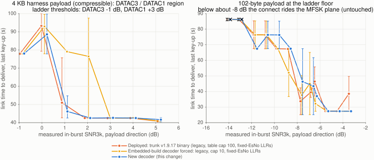

4 KB harness payload (a repeated 34-byte string, so the link compresses it to
a few DATAC1 frames), key-ups by the sending station (5 = no retransmission)
and link time, mean over seeds:

| in-burst SNR3k | trunk | new | cap10 (embedded) |
|---|---|---|---|
| +5.2 .. +3.0 dB | 5 / 41-43 s | 5 / 42-43 s | 5 / 41-43 s |
| +2.0 dB (n = 8) | 5.00 / 42.6 s | 5.00 / 42.6 s | 6.75 / 76.5 s |
| +1.0 dB (n = 8) | 5.25 / 51.0 s | 5.25 / 46.2 s | 7.00 / 79.1 s |
| +0.1 dB (n = 8) | 7.88 / 93.3 s | 7.25 / 88.6 s | 8.00 / 93.0 s |
| -0.9 dB | 7 / 77.9 s | 7 / 78.0 s | 7 / 77.9 s |

Link time on this bench is quantised: a retransmission round adds about 35 s
(42.6 s with none, 76-79 s with one, 99 s with two), so a mean over eight
seeds moves by 4-5 s when ONE seed changes its count.  Read per seed, the
`new` (calibrated) arm against trunk is: +2.0 dB equal on 8 of 8; +1.0 dB
faster on 2, slower on 2, equal on 4; +0.1 dB faster on 2, slower on 1,
equal on 5.  The "10 % / 5 %" that the means suggest is therefore not
resolved by eight seeds, and a four-seed set on the `ladder-thresholds`
branch at +1.0 dB came out the other way (68.6 against 54.9 s).  The embedded
arm's loss is resolved: slower on 7 of 8 seeds at +2.0 dB and 8 of 8 at
+1.0 dB.

What this says, honestly:

- Against what a desktop Mercury ships today, the calibrated LLR scale (the
  `new` arm here; opt-in now) is within the seed-to-seed spread at every
  point: no resolvable gain or loss on AWGN with eight seeds.  Code-level
  it is worth 0.8 to 1.4 dB on the QPSK ladder codes; the ARQ ladder spends its rungs with margin above
  the code cliffs, so that margin is not spent here.  With the defaults the
  decoder's decisions are trunk's.  The ladder's
  thresholds are hard-coded, so a better decoder cannot climb earlier; it
  can only save retries inside a rung.  Lowering the thresholds is a
  separate change that this one makes possible.
- Against an embedded build (codec2's `#ifdef __EMBEDDED__` cap of 10
  iterations), the gain is large: 1.5-1.8x the link time at +1 and +2 dB
  (79 against 51 s, 76 against 43 s, eight seeds each).
  The deadline replaces that cap, so a slow host keeps the full decoder and
  bounds its worst case in time rather than in iterations.

### The defaults against 1.9.18

After the rebase onto 1.9.18 the same bench was run with this branch's
DEFAULTS (fixed LLR scale, per-code policy) against the pristine f609b8f
binary: 4 KB payload, eight seeds, the three points where decoders differ
(`ldpc-figures/data/ab_defaults_1918.csv`, 48 runs).  Key-ups by the sending
station and virtual time of the last key-up, per seed:

| in-burst SNR3k | identical key-up count | default build faster | default build slower |
|---|---|---|---|
| +2.0 dB | 8 of 8 (5 key-ups, last key-up within 0.3 s) | 0 | 0 |
| +1.0 dB | 4 of 8 | 4 (5 key-ups against 6: 42.5 s against 54.6-75.7 s) | 0 |
| +0.1 dB | 6 of 8 | 1 (8 against 14 key-ups) | 1 (12 against 8) |

So the default build is not bit-identical to trunk end to end, and the
reason is known: the policy decoder for DATAC1 is the table sum-product
(`spt`), whose two-segment phi table is within 0.04 dB of the exact `phi0()`
but not the same function; at the DATAC1 cliff it converges on slightly more
frames (FER 0.214 against 0.232 at Eb/N0 1.25 dB, 2000 frames, about two
standard errors), and on the four +1.0 dB seeds it decoded all nine DATAC1
frames where the legacy loop missed one and bought a retransmission round.
At +0.1 dB the DATAC3/DATAC1 probes sit on their cliff and one seed went each
way.  `LDPC_ALG=sp` is the bit-exact legacy result for anyone who wants it;
the reviewer's own measurement ("matches or slightly beats mercuryv2" on the
fixed scale) is the same observation.  Different binaries also differ by up
to 0.3 s in WHEN the same key-ups happen (decode time moves the ACK); the
bench reproduces one binary's own run to about a 20 ms block.

- At the ladder floor (102-byte payload, two seeds per point) the three arms
  agree within the seed-to-seed spread down to the point where every arm
  stops connecting (about -13 dB); single points differ by up to 15 s in
  either direction with no trend, which two seeds cannot separate from
  noise.  Below about
  -8 dB the CALL/ACCEPT handshake rides the MFSK plane, which has its own
  decoder and is untouched here, and at -7 .. -8 dB the DATAC16 CALL is lost
  to acquisition before the LDPC decoder gets a vote.  The 200 Hz modes' code
  has several dB of margin over their acquisition threshold; the decoder is
  not what sets their floor.

A first version of this comparison used `cap10` as the "deployed" arm.  The
mixed-binary runs (trunk sender with this receiver and the reverse) showed it
was not: trunk's receiver decoded frames the cap-10 receiver lost, which led
to the `#ifdef __EMBEDDED__` guard around `max_iter = 10` in `freedv_700.c`.
Desktop builds have always run the code tables' limit of 100.

Reproduce: `tests/integration/ab_sweep.sh OUT PARALLEL "trunk new emul" "NO_LIST"
"SEEDS" PAYLOAD_KB` with `MERCURY_TRUNK_BIN` pointing at a trunk build;
the figure `end_to_end_ab.svg` was drawn on 2026-10-09 by a MATLAB script
from `docs/ldpc-figures/data/ab_runs.csv` and is kept as drawn.

## Running it

```sh
make && make -C tests test_ldpc_ctx test_ldpc_modes test_llr_qam test_ldpc_fer test_freedv_harq && ./tests/test_ldpc_ctx && ./tests/test_ldpc_modes && ./tests/test_ldpc_fer
LDPC_LLR_CALIBRATED=1 ./mercury ...               # opt in to the estimate-driven LLR scale
./mercury -B                              # ns per iteration per code on this host
make -C utils/golden all                  # ldpc_sweep, ldpc_bench, llr_bench, ldpc_export
make -C utils/golden -j4 sweep            # every curve under docs/ldpc-figures/data, about 6 minutes
utils/golden/ldpc_sweep --crossings docs/ldpc-figures/data/ldpc_fer_H_256_768_22.csv   # one curve's crossings
```

## Follow-ups (not in this change)

The LLR scale, in a future change, as laid out under "LLR scale": standard
channel presets first, then a decision-free pilot-based noise-variance
estimate for the decoder and a re-calibrated ladder SNR, then FER validation
per mode and preset (0.8 to 1.4 dB at the code level on the QPSK ladder
codes is available when the estimate is right); trim the `[ldpc]` INI and environment
surface to the chosen defaults once settled; allocate only the active path's
message buffers; offset min-sum per code (not in the C decoder; the dated MATLAB sweep
`matlab-2026-10-09/nms_tuning.txt` put a 0.4 offset at or slightly better
than belief propagation on H_4096_8192_3d and H_256_768_22 only); layered scheduling (half the iterations); fold
the MFSK backend's own min-sum decoder into this context;
VOLK for the OFDM acquisition correlators and the resampler, which are the
remaining Pi 4 CPU cost; higher-rate / rate-compatible codes for the 32-256
QAM modes the demapper now supports.
